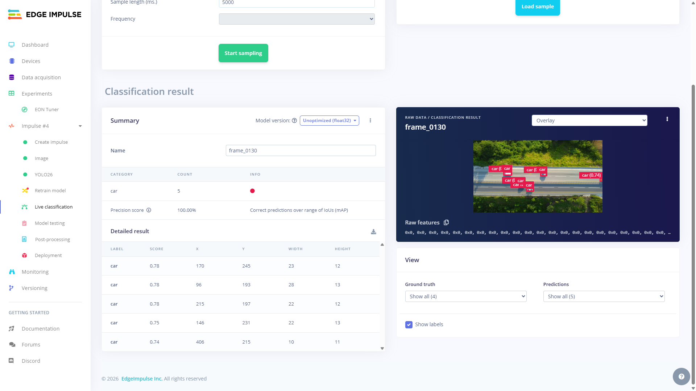
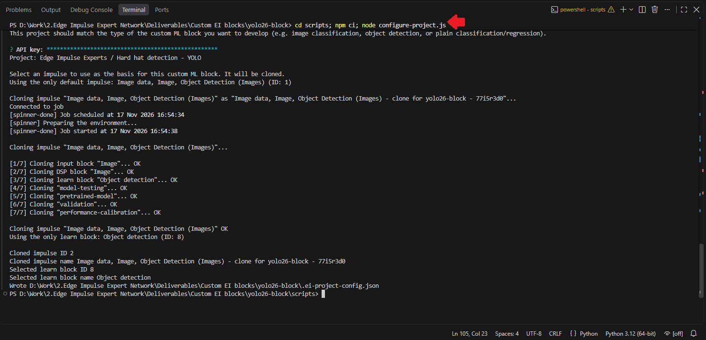
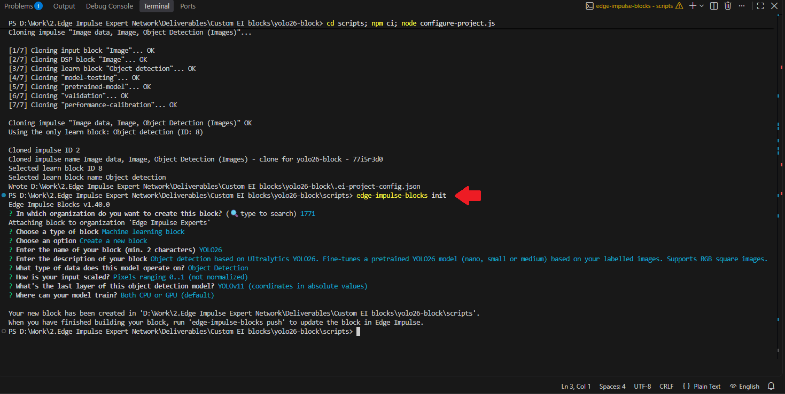
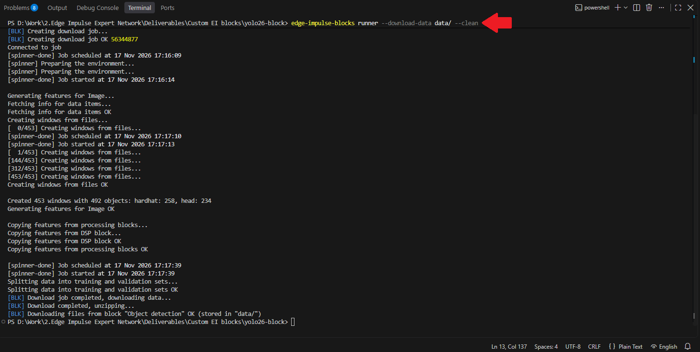
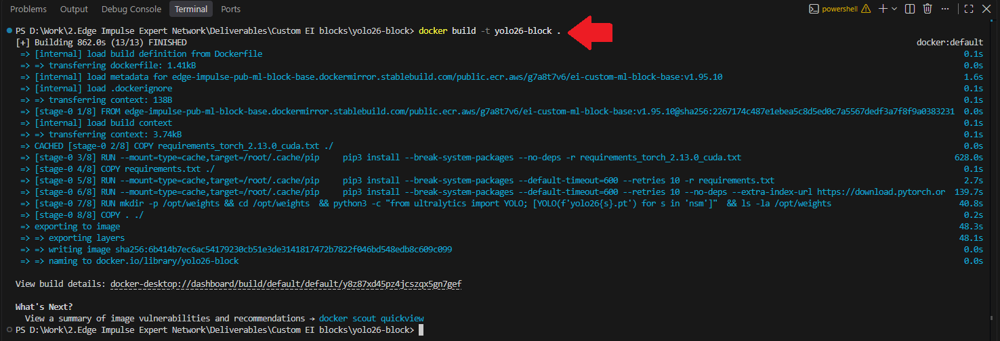
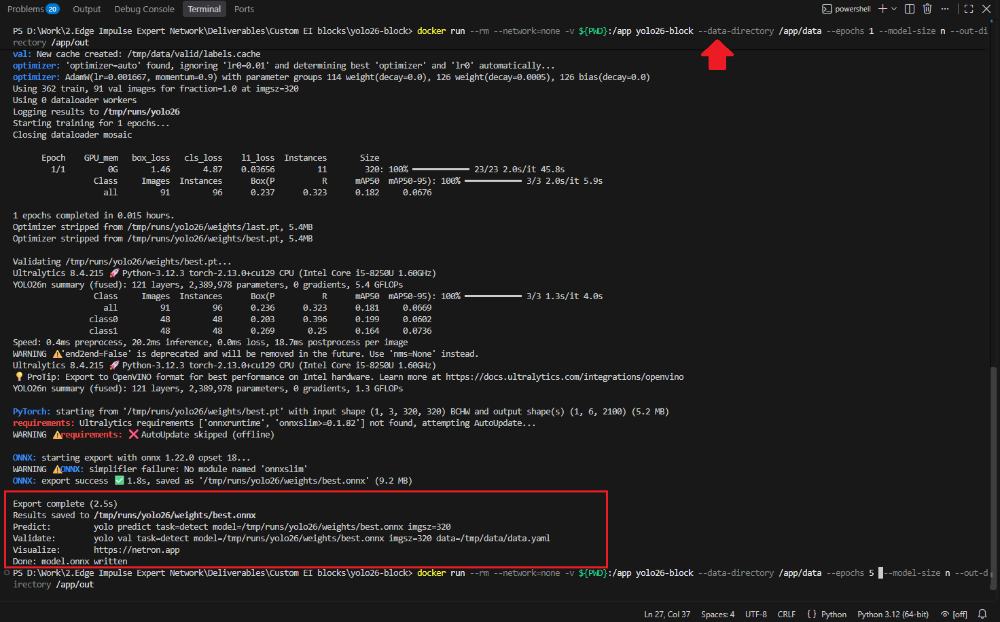
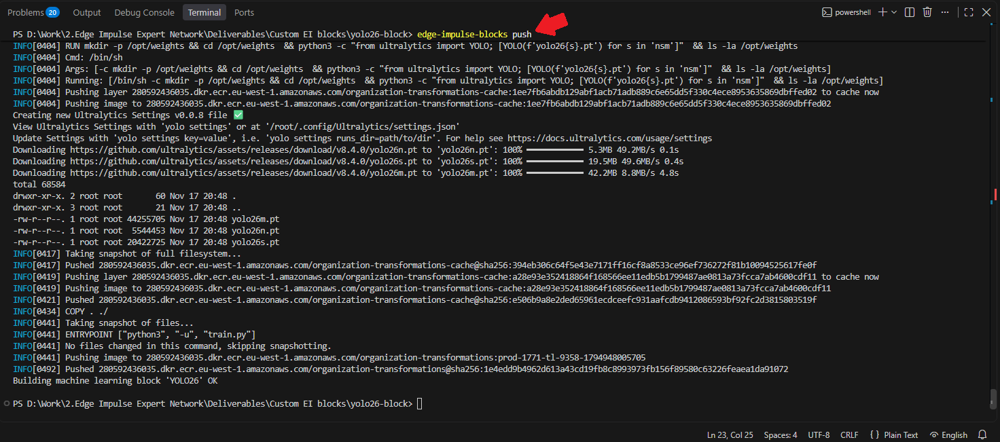
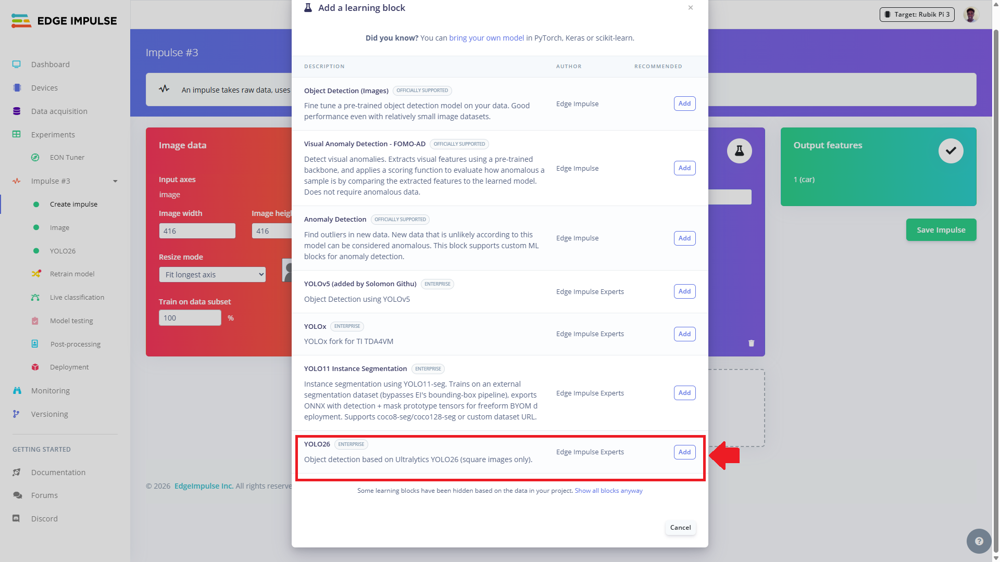

# Train YOLO26 models in Edge Impulse



👉 [Explore YOLO26 project in Studio](https://studio.edgeimpulse.com/public/1168120/latest)

[YOLO26](https://docs.ultralytics.com/models/yolo26) is the newest YOLO model from Ultralytics. It is designed for edge deployment with a simpler architecture than earlier YOLO models and strong accuracy on small objects.

This repository allows you to use YOLO26 as a learning block in an Edge
Impulse object detection project. You can train a custom detector using
data managed by Edge Impulse, select a YOLO26 model size, and use the
resulting model in the Edge Impulse deployment workflow.

If you are looking for the Keras example, see [edgeimpulse/example-custom-ml-block-keras](https://github.com/edgeimpulse/example-custom-ml-block-keras).

As a primer, read the [Custom learning blocks](https://docs.edgeimpulse.com/docs/edge-impulse-studio/learning-blocks/adding-custom-learning-blocks) page in the Edge Impulse docs.

#### Model parameters

| Parameter | Default | Description |
| --- | --- | --- |
| `epochs` (Number of training cycles) | 30 | Number of epochs to train for. |
| `model-size` (Model size) | `n` | `n` = Nano, `s` = Small, `m` = Medium. |
| `batch-size` (Batch size) | 16 | Reduce this for larger models. Optional. |

#### Limitations

* **Square images only.** The image size in your Impulse must have the same width and height, for example 640x640 pixels.
* **Model sizes.** Nano, Small and Medium variants are included. The Large and Extra Large variants are not.
* **Object detection only.** The block does not train the other YOLO26 supported tasks (segmentation, pose, oriented bounding boxes, classification).

## Running via Docker

You run this pipeline via Docker. This encapsulates all dependencies and packages for you.

1. Install [Docker Desktop](https://www.docker.com/products/docker-desktop/).
2. Install the latest version of the [Edge Impulse CLI](https://docs.edgeimpulse.com/docs/edge-impulse-cli/cli-installation).
3. Create a new Edge Impulse project and add image dataset. Under Create impulse, add an Image data block with a square image size, an Image processing block and any object detection learning block, then save the impulse.
4. Open a command prompt or terminal window in this folder.
5. Connect this folder to your project. The script asks for the Edge Impulse project API key (it needs admin rights) and which impulse to clone. Afterwards you will have an .ei-project-config.json file:
```
$ cd scripts
$ npm ci
$ node configure-project.js
$ cd ..
```



6. Initialize the block:

    ```
    $ edge-impulse-blocks init
    ```



7. Fetch the data from your project. --clean replaces any earlier download:

    ```
    $ edge-impulse-blocks runner --download-data data/
    ```



8. Build the container:

    ```
    $ docker build -t custom-ml-pytorch .
    ```



9. Run the container to test the script (you don't need to rebuild the container if you make changes):

    **macOS, Linux**

    ```
    $ docker run --network=none --rm -v $PWD:/app custom-ml-pytorch --data-directory /app/data --epochs 30 --learning-rate 0.01 --out-directory out/
    ```

    **Windows (Command prompt)**

    ```
    $ docker run --network=none --rm -v "%cd%":/app custom-ml-pytorch --data-directory /app/data --epochs 30 --learning-rate 0.01 --out-directory out/
    ```

    **Windows (Powershell)**

    ```
    $ docker run --network=none --rm -v ${PWD}$:/app custom-ml-pytorch --data-directory /app/data --epochs 30 --learning-rate 0.01 --out-directory out/
    ```

    > **Training on GPU:** If you're on an x86 machine with an Nvidia GPU, you can pass `--gpus=all` (right after `docker run`) to train on GPU.

10. This creates `.onnx` and `best.pt` files in the 'out' directory.



If training stops while reading the data, check that the download is complete. This command compares the file size that the `.npy` header promises with the real size. If the two numbers differ, download the data again with `--clean`.

```
$ docker run --rm --entrypoint python3 -v ${PWD}:/app yolo26-block -c "import numpy as np,os; f=open('/app/data/X_split_train.npy','rb'); v=np.lib.format.read_magic(f); s,fo,d=(np.lib.format.read_array_header_1_0(f) if v==(1,0) else np.lib.format.read_array_header_2_0(f)); print('shape',s,'dtype',d,'expected',f.tell()+int(np.prod(s))*d.itemsize,'actual',os.path.getsize('/app/data/X_split_train.npy'))"
```

#### Adding extra dependencies

If you have extra packages that you want to install within the container, add them to `requirements.txt` and rebuild the container.

PyTorch is installed in the Dockerfile from the CUDA 12.9 wheel index with only the CUDA wheel libraries that are not already supplied by the base image. This keeps the image smaller than installing the full default PyTorch CUDA dependency set from PyPI.

#### Adding new arguments

To add new arguments, add them to `parameters.json` and read them in `train.py`. See [Custom learning blocks > Arguments to your script](https://docs.edgeimpulse.com/docs/edge-impulse-studio/learning-blocks/adding-custom-learning-blocks#arguments-to-your-script).

## Pushing the block back to Edge Impulse

You can also push this block back to Edge Impulse, that makes it available like any other ML block so you can retrain your model when new data comes in, or deploy the model to device. See [Docs > Adding custom learning blocks](https://docs.edgeimpulse.com/docs/edge-impulse-studio/organizations/adding-custom-transfer-learning-models) for more information.

1. Push the block:

    ```
    $ edge-impulse-blocks push
    ```



2. The block is now available under any of your projects via **Create impulse > Add new learning block**.



## Changing the block type (e.g. image classification, object detection or regression)

If you want to change the block type because you're classifying a different data type, or build a model with a different output format, run:

```
$ rm parameters.json  .ei-block-config
$ edge-impulse-blocks init
```

And answer the wizard. This'll create a new parameters.json file.

## Working with coding agents

You can use your favourite AI agent to help you implement new custom ML blocks. E.g. prompt:

```
Modify this repository so it implements a 1D convolutional neural network. Read AGENTS.md first.
```
